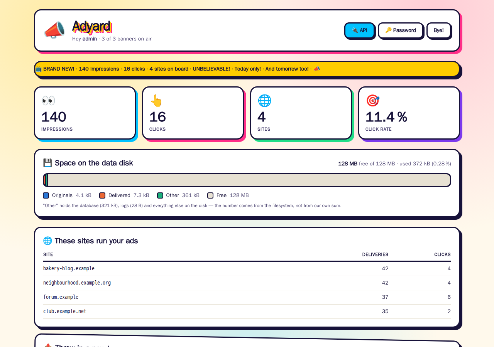
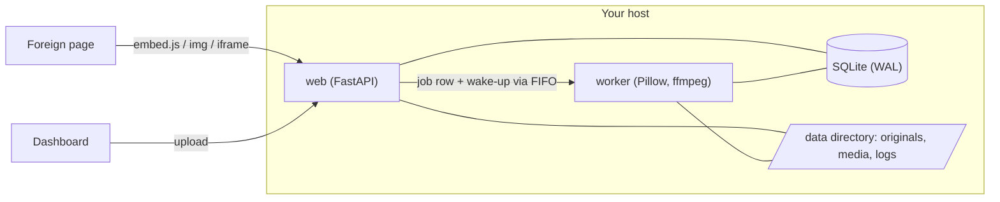

# Adyard

**Self-hosted banner ads: upload an image or video, get it web-optimised, embed
it anywhere with one line, and count impressions and clicks without storing a
single IP address.**



A small service for running your own banners on your own and friendly sites —
no ad network, no third-party tracking. It is deliberately boring to operate:
one Python web process, one media worker, SQLite, and a data directory.

Built with AI assistance.

## Features

- **Upload and forget.** Images become WebP (animated GIFs stay animated), videos
  become H.264/AAC with the index moved to the front. If transcoding would make
  an already browser-ready file bigger, the original wins.
- **Five ways to embed:** a script that reserves the aspect ratio (no layout
  jump on the host page), the same with width/alignment/radius options, an
  iframe, a plain `` for places that strip JavaScript, and JSON for your own
  integration. `random` works wherever a banner id goes.
- **Honest counting.** An impression is counted once the banner has actually
  been on screen (`IntersectionObserver`), once per visitor, banner and day.
  Visitors are told apart by a daily-rotating hash — the next day the same
  visitor is unrecognisable, and no raw IP ever reaches the database.
- **Which sites run your ads,** counted on every request (not only on counted
  impressions), without your own host or test pages.
- **Quiet when idle.** The worker sleeps on a pipe instead of polling, log lines
  are buffered, and a mount guard stops the service from writing into an empty
  directory when its data disk drops out.
- **Small team accounts.** No public sign-up: the first admin is created at
  start-up, further accounts from the dashboard.

## Quick start

```bash
git clone https://github.com/Juice-de-Orange/adyard.git && cd adyard
cp .env.example .env
docker compose up -d --build
docker compose logs web | grep "First admin"   # the generated password, shown once
```

Open <http://localhost:8080>, log in as `admin` with that password and choose a
new one — Adyard asks for it on the first login. To pick the first password
yourself, set `ADYARD_ADMIN_PASSWORD` in `.env` before the first start.

Port 8080 already taken? Set `ADYARD_PORT` in `.env` (e.g. `ADYARD_PORT=9090`)
and the same port in `ADYARD_PUBLIC_URL`, then open that port instead.

The generated password is only in the container log, and `docker compose down`
removes that log. If it is gone before your first login, start over with
`docker compose down -v` (this deletes the data volume, uploads included) and
`docker compose up -d`: a new password is generated. `ADYARD_ADMIN_PASSWORD` is
only read while no account exists, so setting it later does not reset anything.

For a public setup, put the service behind a reverse proxy with TLS and set
`ADYARD_PUBLIC_URL` (e.g. `https://ads.example.com`) — the embed snippets point
there. Running it without Docker: [docs/deploy/systemd.md](docs/deploy/systemd.md).

Visitors are told apart by their address, so Adyard believes `X-Forwarded-For`
only from the peers in `ADYARD_TRUSTED_PROXIES` (default `127.0.0.1,::1`: a proxy
on the same machine, the systemd setup). Reached directly, as in the quick start,
nothing needs setting — a forged header is ignored. Behind a proxy in front of
the Docker setup, its connections arrive from a Docker network, so set the
proxy's container address or that network (e.g. `172.16.0.0/12`, the range Docker
uses for its bridge networks); otherwise every visitor looks like the proxy and
is counted once a day. Trust nothing wider than you have to: any peer in the list
can claim any address.

## Backup, restore and update

Commands for the Docker setup, run in the checkout. Without Docker:
[docs/deploy/systemd.md](docs/deploy/systemd.md#backup-and-restore).

**Backup** — while the service runs:

```bash
(umask 077; docker compose exec -T web python -m app.backup - > adyard-backup-$(date +%Y%m%d-%H%M%S).tar)
```

One tar file with a consistent copy of the database (SQLite's online backup
API, so nothing that still sits in the write-ahead log is missed), the originals,
the delivered media and the generated session key and visitor salt. Logs are not
included. It holds password hashes and secrets: keep it private (`umask 077`
makes the file readable for you only). To write it into
the data volume instead, give a directory: `python -m app.backup /data/backups`.

**Restore** — into the same or a brand-new installation (after
`docker compose down -v`, too):

```bash
docker compose stop web worker
docker compose run --rm -T --no-deps web python -m app.restore - < adyard-backup-20261012-120000.tar
docker compose up -d
```

The backup is unpacked and checked first; only then is the current data replaced.
Nothing is deleted: what was there before is moved to
`/data/pre-restore-<time>/` in the volume. Remove it once all is well:
`docker compose exec web rm -rf /data/pre-restore-<time>`. The restore refuses to
run while web or worker still has the database open.

**Update** — take a backup, then:

```bash
git pull
docker compose up -d --build
docker compose logs --tail 20 web worker
```

Database changes are applied when the service starts. To pin a release, use
`git fetch --tags && git checkout v<version>` instead of `git pull`.

*Coming from v0.1.0*, which has no backup command yet: take a cold copy of the
data volume first, then update as above.

```bash
docker compose stop web worker
(umask 077; docker compose run --rm -T --no-deps web tar -C /data -cf - . > adyard-v0.1-data.tar)
```

(To go back: check out `v0.1.0`, `docker compose build`, `docker compose stop web worker`,
then `docker compose run --rm -T --no-deps web tar -C /data -xf - < adyard-v0.1-data.tar`
and `docker compose up -d`.) The first start of the new version converts the stored media paths to paths
relative to the data directory and says so in the log of whichever of web and
worker starts first (`docker compose logs | grep "media path"` shows
`… media path(s) converted to relative`); from then on the data directory can move. Move it only after that
first start.

*Coming from maxads* — the name of this project until v0.2. Update in place, in
the checkout you have (`git pull` follows GitHub's redirect;
`git remote set-url origin https://github.com/Juice-de-Orange/adyard.git` makes
it explicit). Compose names the project, and with it the data volume, after that
directory — `maxads_data` for a checkout called `maxads` — so the data stays
where it is. A new checkout in another directory would start with an empty
volume instead; to point it at the old one, run
`echo COMPOSE_PROJECT_NAME=maxads >> .env` there before its first start
(`docker volume ls` shows the name). After the update:

- The `MAXADS_*` variables in `.env` still work; web and worker log one warning
  per old name. `sed -i 's/^MAXADS_/ADYARD_/' .env` renames them; an `ADYARD_`
  name wins over its old one. (v0.1.0 reads only the old names: rename them
  back before going back to it.)
- The database file in the volume keeps its old name, `maxads.db`, and is used
  as it is (the log says so at start).
- Everyone signs in once more: the session cookie has a new name.
- The embed box on host pages has the class `adyard` and `data-adyard` instead
  of `maxads` and `data-maxads`; CSS on a host page aimed at the old class needs
  the new one.

## Embedding

```html
<!-- one specific banner -->
<script src="https://ads.example.com/embed/<id>.js" async></script>

<!-- a random active banner, max. 300 px wide, left-aligned, rounded corners -->
<script src="https://ads.example.com/embed/random.js?width=300&align=left&radius=12" async></script>

<!-- iframe -->
<iframe src="https://ads.example.com/frame/<id>"
        style="width:100%;aspect-ratio:16/9;border:0" loading="lazy"></iframe>

<!-- no JavaScript at all: the request itself counts as the impression -->
<a href="https://ads.example.com/c/<id>">" alt="Advertisement"></a>
```

The dashboard shows the ready-to-copy code for every banner, and `/api` lists
all endpoints.

## How it works



The web process never transcodes: a video takes minutes and would block
requests and get lost on every restart. Uploads become a row in a job table;
the worker claims it with an atomic `UPDATE … WHERE state='pending'` and is woken
through a FIFO in `/run`. The decisions behind this — and a few traps they avoid,
such as H.264 files that play in VLC but hang forever in Chrome — are in
[docs/ARCHITECTURE.md](docs/ARCHITECTURE.md).

### Measured, not guessed

On the original deployment, idle for 60 s:

| | idle |
|---|---|
| disk accesses | **0** — the kernel page cache absorbs everything |
| worker CPU | 0.0 ms |
| web CPU | ~50 ms (0.08 % of one core) |
| memory | web ~33 MB, worker ~14 MB |

## Tech stack

Python 3.13 · FastAPI · Jinja2 · SQLite · Pillow · ffmpeg · argon2 · Docker /
systemd · Tailwind CSS (prebuilt into `app/static/`, nothing loaded from a CDN).

## Development

```bash
python3.13 -m venv .venv && . .venv/bin/activate
pip install -r requirements-dev.txt
python -m pytest -q        # install ffmpeg, or the two video tests skip themselves
python -m ruff check .
```

Run it locally without Docker (the worker needs `ffmpeg` and `ffprobe` on the PATH and refuses to
start without them; uvicorn listens on 8000, so the public URL has to say so or the embed snippets
point at the wrong port):

```bash
export ADYARD_BASE=/tmp/adyard ADYARD_REQUIRE_MOUNT=0 RUNTIME_DIRECTORY=/tmp/adyard-run
export ADYARD_PUBLIC_URL=http://localhost:8000
uvicorn app.main:create_app --factory --reload &
python -m app.worker
```

Changed CSS classes in a template? Rebuild the stylesheet with
`sh scripts/build-css.sh` (downloads the pinned standalone Tailwind CLI once, no
Node.js needed) and commit `app/static/tailwind.css`; CI checks that it matches.

See [CONTRIBUTING.md](CONTRIBUTING.md) for conventions and the pre-commit secret
guard.

## Status

Built in September 2026 and deployed on a single small host since then.
Feature-complete for its purpose; open ideas are in the
[issues](https://github.com/Juice-de-Orange/adyard/issues).

Checked on a fresh clone with the Docker quick start and a real browser (upload, conversion,
delivery, embed on another origin, statistics, pause, delete, restart). Not verified in that check:
the systemd installation from `docs/deploy/`, operation behind a reverse proxy with TLS, and browsers
other than Chromium.

### Known limitations

- **The login throttle counts in memory.** After five failed logins from one
  address or for one account name, further attempts get `429` for 30 seconds,
  doubling with every further failure (up to 15 minutes). The counters live in
  the single web process: a restart forgets them, and someone guessing can also
  lock the real owner of that account name out for that time.
- **No roles.** Every account can do everything, including removing other
  accounts.
- **Browser caches.** A visitor's browser keeps a delivered banner for up to a
  day, so a paused or deleted banner can still appear for someone who saw it
  before; the embed script itself is cached for five minutes.
- **The generated first password** lives only in the container log (see Quick
  start).
- **Not verified on a real host:** the systemd units and the systemd backup and
  restore commands in `docs/deploy/` (their Python parts were run, systemd was not).

## License

[MIT](LICENSE) © 2026 Max Oberrauch
